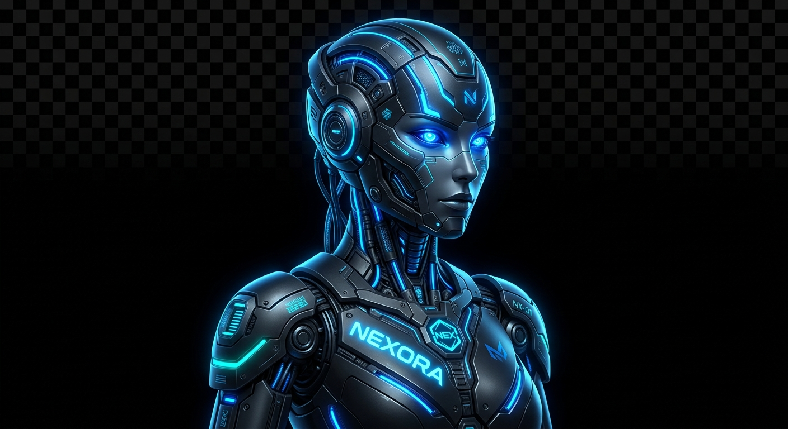

# ⚡ NEXORA AI // NEURAL INTERFACE

> A standalone, professional Windows desktop assistant featuring a cyberpunk robotic visual identity, real-time audio reactivity, system tray integration, and local PC execution tools.



---

## 🚀 Overview

**Nexora** is an advanced desktop companion built to bridge the gap between AI intelligence and native OS interaction. Designed from the ground up with a custom cyberpunk aesthetic, Nexora features real-time audio visualization, background system tray minimization, and powerful local actions to automate your daily workflows.

---

## ✨ Key Features

* **Cyberpunk Graphical Interface**: Built with `PyQt6`, featuring custom-styled dark-mode HUD panels, futuristic typography, and a dynamic real-time audio visualizer.
* **Live Audio Reactivity**: The neural visualizer adapts dynamically in real-time across multiple assistant states (*Idle, Listening, Thinking, Speaking*).
* **System Tray Minimization**: Runs smoothly in the Windows system tray with a right-click menu (`Open Nexora HUD`, `Shut Down`) for background availability.
* **Standalone Executable (.exe)**: Fully compiled via PyInstaller into a standalone package with custom branding and bundled configuration files.
* **Local PC Automation**: Capable of executing system tasks such as opening applications, performing web lookups, taking screenshots, and monitoring local devices.

---

## 🛠️ Technology Stack

* **Language**: Python 3.10+
* **GUI Framework**: PyQt6 (`QMainWindow`, `QThread`, `QSystemTrayIcon`, custom `QPainter` visualizer)
* **AI & Audio Engine**: OpenAI API (Whisper transcription, GPT-4 chat completion, TTS voice synthesis), `PyAudio`, `sounddevice`
* **Distribution**: PyInstaller (`--onefile`, `--noconsole`)

---

## 📂 Project Architecture

```text
project_assistant/
│
├── actions/             # Local PC automation & system tools (pc_tools.py)
├── config/              # Configuration schemas and secure settings
├── core/                # Core assistant logic, prompt instructions, audio devices
├── memory/              # Multi-path dynamic configuration manager (config_manager.py)
├── dist/                # Bundled standalone executable (.exe) output
├── gui_app.py           # Main PyQt6 cyberpunk graphical user interface & tray handler
├── main.py              # Assistant core orchestrator loop
├── requirements.txt     # Project dependencies
└── README.md            # Project documentation
